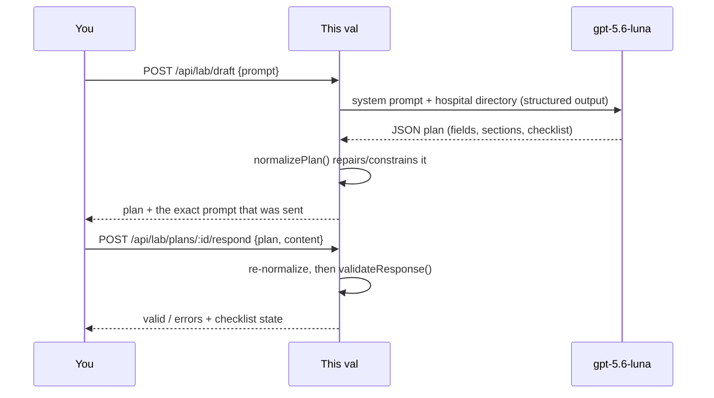

# Elicitation Lab

[Open the lab](url:main.http.ts)

Type a clinical request in plain English — *"radiology contrast CT where consent is a hard gate"* — and a live OpenAI model drafts the MCP `elicitation/create` request: department, specialty, routing code, grouped fields, enums, numeric bounds, conditional checklist gates, and a pinned hospital. You answer the form and the server validates your answer against **that generated schema**.

Nothing about the form is pre-baked. There is no dummy data path: every field on screen came out of a model call made seconds earlier.



## What one prompt can unlock

| Prompt | What it demonstrates |
| --- | --- |
| Cardiology pre-op for TAVR | Department + specialty routing, enums, structural-heart checklist |
| Radiology contrast CT, consent as a hard gate | Conditional gate that only clears when contrast is chosen |
| Paediatric weight-based dosing | Numeric fields with min/max bounds |
| Tumour board intake, pathology number required | Required free text driving a hard stop |
| Emergency triage handoff | Urgent priority, acuity-driven gates |
| "Remember St. Anselm, never ask me again" | Hospital memory — pinned site, no hospital field |
| 7-field pre-anaesthesia assessment | Model-authored section grouping |

Each example card in the UI states what it is meant to show.

## Why the server re-checks everything

The client echoes the generated plan back with its answer (Val Town isolates do not keep memory between requests). The server therefore never trusts a posted schema:

- `normalizePlan()` rebuilds the plan from whitelisted field types, caps enums at 8 values, drops dangling section and checklist references, strips prompt-injection-shaped checklist items, and accepts only server-known hospital objects.
- `validateResponse()` then checks required fields, primitive types, enum membership, integer-ness and min/max bounds.
- Hospitals are ids from the server's directory, so the model can pick a site but never invent one.

The generated plan is also the `requestedSchema` in the `elicitation/create` frame shown in the JSON-RPC tab.

## API

| Method and path | Purpose |
| --- | --- |
| `GET /api/lab/meta` | Hospitals, example prompts, starter plans, and the literal system prompt |
| `POST /api/lab/draft` | `{prompt, hospitalId?}` → generated plan, timing/token meta, transcript, next example. `502` with a hand-written `fallback` plan if the proxy is unavailable |
| `POST /api/lab/plans/:id/respond` | `{plan, action, content, ticked}` → `200` validated result with checklist state, or `422` with per-field errors |
| `POST /api/lab/rpc` | Rejects `elicitation/create` with a JSON-RPC error and a pointer to the UI — this is not an interactive MCP transport |

```sh
curl -X POST "$LAB_URL/api/lab/draft" \
  -H 'Content-Type: application/json' \
  -d '{"prompt":"Neurology pre-thrombolysis checklist with NIHSS","hospitalId":"northshore"}'
```

## OpenAI usage

Generation goes through Val Town's shared OpenAI integration (`https://esm.town/v/std/openai/main.ts`) — no API key required, `gpt-5.6-luna` by default, 100 requests/day per user, and the proxy may substitute models. To lift the limit, set your own key:

👉 Add OPENAI_API_KEY here: https://www.val.town/x/arthrod/elicitation-lab-real/environment-variables?key=OPENAI_API_KEY

## Layout

- `main.http.ts` — wires Val Town asset services into `backend/app.ts`.
- `backend/generate.ts` — OpenAI call, JSON schema for structured output, hospital directory, example prompts.
- `backend/draft.ts` — `/meta` and `/draft` routes, fallback plan.
- `backend/lab.ts` — validation endpoint and the honest `/rpc` error.
- `lab/model.ts` — the plan contract: types, `normalizePlan`, `validateResponse`, `checklistState`, starter plans.
- `lab/index.html`, `lab/app.js`, `lab/lab.css` — UI (composer, generated form, checklist, raw panels).

## Caveats

Illustrative clinical workflows only: no patient data is stored, no hospital system is written to, and responses are not persisted. The generated schemas are AI output — reviewed by the normaliser, not by a clinician.
